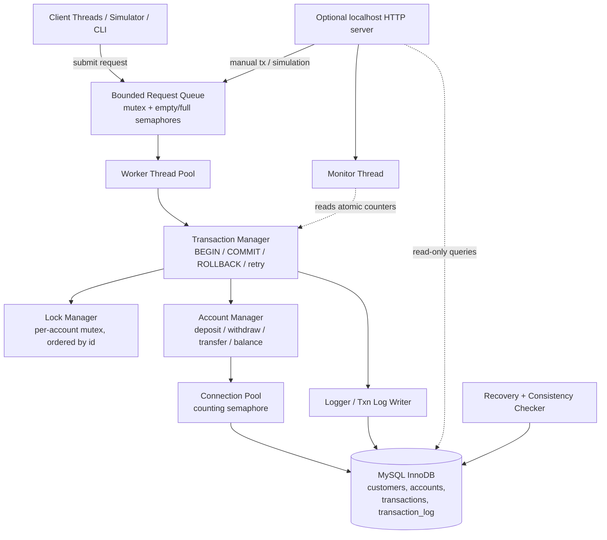

# ARCHITECTURE.md

## 1. Architecture Style
Layered, producer–consumer pipeline with a worker thread pool. Two cooperating concurrency layers:

- **OS layer (in-process):** per-account mutexes, bounded request queue (mutex + semaphores), connection-pool semaphore
- **DBMS layer (MySQL/InnoDB):** ACID transactions, row locks (`SELECT ... FOR UPDATE`), isolation level, COMMIT/ROLLBACK, durable log

## 2. High-Level Diagram

## 3. Components
| Component | Responsibility | OS / DBMS concept |
|-----------|---------------|-------------------|
| Client / Simulator | Generates requests | Multithreading |
| Bounded Request Queue | Hands requests to workers; blocks when full/empty | Producer–consumer, semaphores, mutex |
| Worker Thread Pool | Fixed N threads executing requests | Thread management, resource mgmt |
| Transaction Manager | Wraps each op in a DB transaction; retries on deadlock | ACID, COMMIT/ROLLBACK |
| Lock Manager | Acquires account mutexes in ascending id order | Mutex, critical section, deadlock avoidance |
| Account Manager | Business rules and SQL for each operation | SQL, constraints |
| Connection Pool | Limits concurrent DB connections | Counting semaphore, resource mgmt |
| Logger / Txn Log | Records PENDING → COMMITTED / ROLLED_BACK | Transaction logging, recovery |
| Recovery | On startup resolves unfinished log entries | Recovery |
| Consistency Checker | Verifies invariants | Integrity |
| Monitor | Prints live stats | Inter-thread communication (atomics) |
| Optional Dashboard | Localhost-only visual control plane; uses snapshots and the existing queue | HTTP, SSE, read-mostly observability |

## 4. Request Lifecycle (Transfer A → B)
1. Client creates `Request{type, from, to, amount, req_id}` and `push()`es it (waits on `empty` semaphore if queue full)
2. Worker `pop()`s it (waits on `full` semaphore)
3. Transaction Manager acquires a DB connection (pool semaphore)
4. Log row inserted: status `PENDING`
5. Lock Manager locks account mutexes in **ascending id order** (critical section begins)
6. `START TRANSACTION`
7. `SELECT balance FROM accounts WHERE id IN (a,b) ORDER BY id FOR UPDATE`
8. Validate: accounts exist, amount > 0, balance >= amount
9. `UPDATE` both balances; `INSERT` ledger rows into `transactions`
10. `COMMIT` → log row `COMMITTED`; on any error `ROLLBACK` → log row `ROLLED_BACK` + reason
11. Release mutexes (RAII), return connection, update counters, fulfil the request's `std::promise`

## 5. Concurrency Strategy
- **Lock ordering:** always lock lower account id first → no circular wait → no deadlock in the mutex layer
- **DB deadlock fallback:** MySQL error 1213 / 1205 → rollback and retry up to 3 times with jittered backoff
- **Isolation:** `REPEATABLE READ` (InnoDB default) plus explicit `FOR UPDATE`; documented in `DECISIONS.md`
- **Critical sections:** only the read-validate-write block; logging and counters stay outside it
- **Unsafe mode:** compile-time/runtime flag that bypasses the Lock Manager and `FOR UPDATE` to demonstrate lost updates

## 6. Failure Handling & Recovery
| Failure | Behavior |
|---------|----------|
| Validation error (insufficient funds) | ROLLBACK, log `ROLLED_BACK(reason)` |
| DB deadlock / lock timeout | ROLLBACK, retry, then fail with reason |
| Worker exception | RAII releases locks, ROLLBACK, request fails |
| Process crash | InnoDB auto-rolls back uncommitted work; on restart Recovery marks leftover `PENDING` rows `ROLLED_BACK(crash)` and runs Consistency Checker |

## 7. Tech Stack
C++20 · `std::thread`, `std::mutex`, `std::counting_semaphore` · MySQL 8 (InnoDB) · MySQL C API (`libmysqlclient`) · CMake · GoogleTest · ThreadSanitizer

## 8. Deployment
Single machine, one process, one local MySQL instance. The optional dashboard
binds only to `127.0.0.1`; it has no authentication and is a demo tool, not a
production deployment surface. HTTP handlers never hold account or queue locks
while serving requests. Manual transactions enter the same bounded queue and
`TransactionManager` path as simulator requests.
