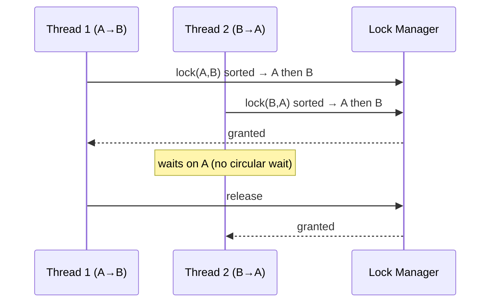

# DESIGN.md

## 1. Database Design

### ER Overview
`customers (1) ──< (N) accounts (1) ──< (N) transactions`
`transactions (1) ── (1..N) transaction_log`

### schema.sql
```sql
CREATE DATABASE IF NOT EXISTS bank;
USE bank;

CREATE TABLE customers (
  customer_id INT AUTO_INCREMENT PRIMARY KEY,
  name        VARCHAR(100) NOT NULL,
  email       VARCHAR(120) NOT NULL UNIQUE,
  created_at  TIMESTAMP DEFAULT CURRENT_TIMESTAMP
) ENGINE=InnoDB;

CREATE TABLE accounts (
  account_id  INT AUTO_INCREMENT PRIMARY KEY,
  customer_id INT NOT NULL,
  balance     DECIMAL(15,2) NOT NULL DEFAULT 0.00,
  status      ENUM('ACTIVE','FROZEN','CLOSED') NOT NULL DEFAULT 'ACTIVE',
  version     INT NOT NULL DEFAULT 0,
  updated_at  TIMESTAMP DEFAULT CURRENT_TIMESTAMP ON UPDATE CURRENT_TIMESTAMP,
  CONSTRAINT fk_acc_cust FOREIGN KEY (customer_id) REFERENCES customers(customer_id),
  CONSTRAINT chk_balance CHECK (balance >= 0)
) ENGINE=InnoDB;

CREATE TABLE transactions (
  txn_id       BIGINT AUTO_INCREMENT PRIMARY KEY,
  request_id   CHAR(36) NOT NULL UNIQUE,          -- idempotency key
  type         ENUM('DEPOSIT','WITHDRAW','TRANSFER') NOT NULL,
  from_account INT NULL,
  to_account   INT NULL,
  amount       DECIMAL(15,2) NOT NULL CHECK (amount > 0),
  status       ENUM('COMMITTED','ROLLED_BACK') NOT NULL,
  created_at   TIMESTAMP DEFAULT CURRENT_TIMESTAMP,
  FOREIGN KEY (from_account) REFERENCES accounts(account_id),
  FOREIGN KEY (to_account)   REFERENCES accounts(account_id),
  INDEX idx_txn_from (from_account, created_at),
  INDEX idx_txn_to   (to_account, created_at)
) ENGINE=InnoDB;

-- Write-ahead style audit log. Written on a SEPARATE connection/transaction so
-- PENDING survives even if the main transaction rolls back or the process dies.
CREATE TABLE transaction_log (
  log_id     BIGINT AUTO_INCREMENT PRIMARY KEY,
  request_id CHAR(36) NOT NULL,
  status     ENUM('PENDING','COMMITTED','ROLLED_BACK') NOT NULL,
  reason     VARCHAR(255) NULL,
  thread_id  VARCHAR(32) NULL,
  attempt    TINYINT NOT NULL DEFAULT 1,
  logged_at  TIMESTAMP(3) DEFAULT CURRENT_TIMESTAMP(3),
  INDEX idx_log_req (request_id),
  INDEX idx_log_status (status, logged_at)
) ENGINE=InnoDB;
```

### Constraints & Indexes
- `CHECK (balance >= 0)` is the last line of defense against overdraft
- `request_id UNIQUE` gives idempotency (a retried request cannot apply twice)
- Composite indexes on `(account, created_at)` speed up statement/history queries

## 2. Key SQL

```sql
-- Transfer (inside START TRANSACTION)
SELECT account_id, balance FROM accounts
 WHERE account_id IN (?, ?) ORDER BY account_id FOR UPDATE;

UPDATE accounts SET balance = balance - ?, version = version + 1 WHERE account_id = ?;
UPDATE accounts SET balance = balance + ?, version = version + 1 WHERE account_id = ?;
INSERT INTO transactions (request_id,type,from_account,to_account,amount,status)
VALUES (?, 'TRANSFER', ?, ?, ?, 'COMMITTED');
COMMIT;
```
```sql
-- Consistency check
SELECT SUM(balance) FROM accounts;                    -- must equal initial total + net deposits - net withdrawals
SELECT COUNT(*) FROM accounts WHERE balance < 0;       -- must be 0
SELECT COUNT(*) FROM transaction_log l
  LEFT JOIN transaction_log f ON f.request_id=l.request_id AND f.status<>'PENDING'
 WHERE l.status='PENDING' AND f.log_id IS NULL;        -- unresolved after recovery must be 0
```

## 3. Class Design (C++)

```cpp
enum class TxType { Deposit, Withdraw, Transfer, Balance };
enum class TxStatus { Pending, Committed, RolledBack };

struct Request {
  std::string request_id; TxType type;
  int from = 0, to = 0; Money amount{};
  std::promise<Result> done;
};
struct Result { TxStatus status; std::string reason; Money balance{}; int attempts = 1; };

class BoundedQueue<T> {            // mutex + 2 counting semaphores
  void push(T); T pop(); void close();
};
class ThreadPool { ThreadPool(size_t n, BoundedQueue<Request>&, TransactionManager&); void join(); };
class LockManager {                // per-account std::mutex, ordered acquire
  ScopedLocks lock(std::initializer_list<int> ids);   // sorts ids, locks ascending, RAII release
};
class ConnectionPool {             // N MYSQL* guarded by counting_semaphore<N>
  Lease acquire(); 
};
class TransactionManager {
  Result execute(Request&);        // retry loop, begin/commit/rollback, logging
};
class AccountManager {             // SQL + business rules, takes a Connection&
  Result deposit(Conn&, int, Money); Result withdraw(Conn&, int, Money);
  Result transfer(Conn&, int, int, Money); Money balance(Conn&, int);
};
class TxnLog { void pending(id); void committed(id); void rolled_back(id, reason); };
class Recovery { void run(); };
class ConsistencyChecker { Report check(); };
class Monitor { void start(); void stop(); };   // reads std::atomic counters
```

### Money type
Use integer **paise/cents** (`int64_t`) in code, `DECIMAL(15,2)` in DB. Never `float`/`double`.

## 4. Interface

CLI flags: `--accounts N --clients N --ops N --workers N --seed S --unsafe --check --recover --verbose --serve --port N`

Monitor output example:
```
[monitor t=5.00s] queue=12/256 active=8 committed=2,431 rolled_back=87 total=2,518
       throughput=486.00 tx/s avg_service_latency=3.10ms lock_waits_total=142
```

The monitor reads relaxed atomic diagnostic counters and does not query MySQL.
`lock_waits_total` counts contended in-process account-mutex acquisitions only;
it is not a count of current waiters or MySQL row-lock waits. Normal simulation
runs startup recovery before client threads are created. `--recover --check`
performs maintenance recovery followed by I1–I5 checking with the supplied
external opening-balance baseline.

Interactive mode (optional): `deposit <acc> <amt>` · `withdraw <acc> <amt>` · `transfer <from> <to> <amt>` · `balance <acc>` · `stats` · `check`.

### Optional dashboard API

`bank --serve --port 8080` binds to `127.0.0.1` and serves `web/index.html`.
The API is read-mostly except for explicitly controlled simulation, manual
transaction, and maintenance commands:

| Method | Path | Purpose |
|---|---|---|
| GET | `/api/stats` | Atomic counters, latency histogram percentiles, queue/pool state, and balance snapshot. |
| GET | `/api/stream` | Server-Sent Events snapshot every 500 ms. |
| GET | `/api/accounts` | Prepared, paginated account/owner read. |
| GET | `/api/transactions` | Prepared latest transaction/log-status read. |
| POST | `/api/simulate` | Validated background simulation start; conflicts return 409. |
| POST | `/api/simulate/stop` | Closes the queue and joins simulation threads. |
| POST | `/api/tx` | Validated manual request through the existing queue/TransactionManager. |
| POST | `/api/check` | ConsistencyChecker I1–I5. |
| POST | `/api/recover` | Recovery report. |
| POST | `/api/reset` | Development-only truncate/reseed requiring `confirm=true`. |

The server does not write balances directly. It uses relaxed atomic counter
snapshots for hot-path statistics, an atomic latency histogram for p95, and
separate prepared read connections for database views. The optional dashboard
is documented by ADR-016; it does not change the core engine's transaction or
locking rules.

## 5. Error Model
Result reasons: `INSUFFICIENT_FUNDS`, `ACCOUNT_NOT_FOUND`, `ACCOUNT_NOT_ACTIVE`, `INVALID_AMOUNT`, `SAME_ACCOUNT`, `DB_DEADLOCK_EXHAUSTED`, `DB_ERROR`, `INTERNAL_ERROR`.

## 6. Presentation Diagrams (recommended)
Include: architecture diagram (from `ARCHITECTURE.md`), transfer sequence diagram, deadlock illustration (A→B vs B→A, then with ordering), and a race-condition timeline (lost update) vs safe timeline.


