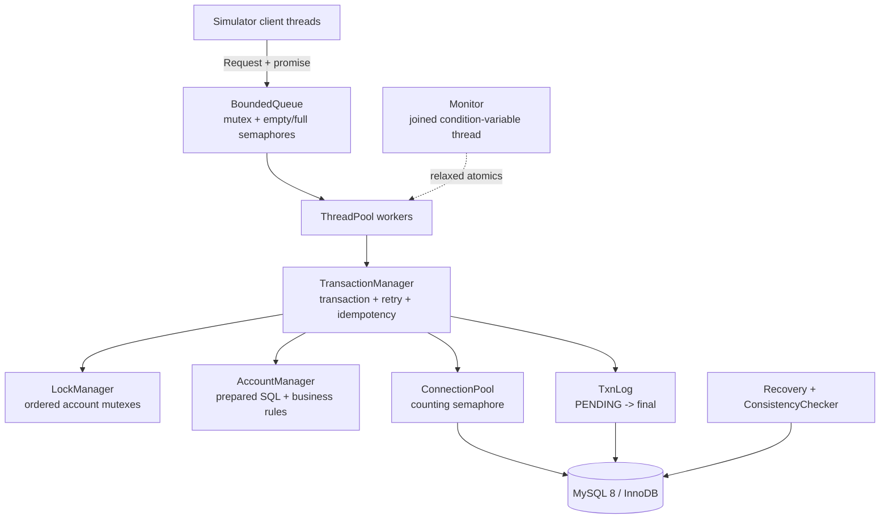
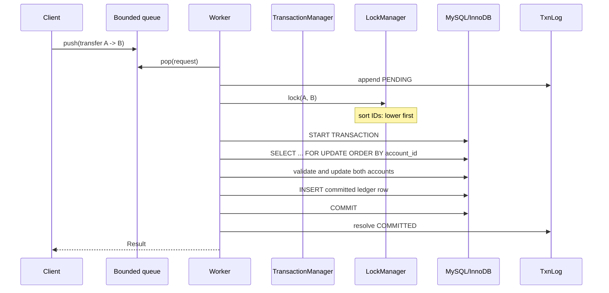
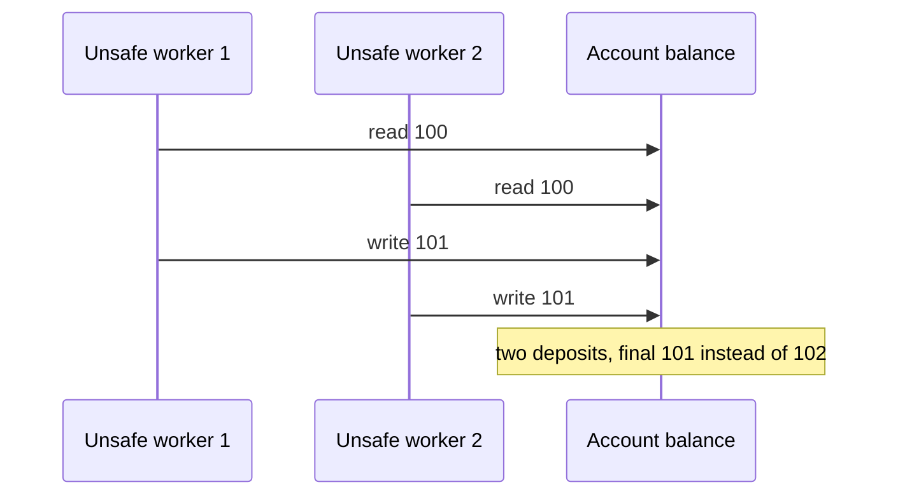

# Multithreaded Bank Transaction Management System

## Final Technical Report

**Project:** Multithreaded Bank Transaction Management System  
**Course area:** Operating Systems and Database Management Systems  
**Implementation:** C++20, `std::thread`, mutexes, semaphores, MySQL 8/InnoDB, CMake, GoogleTest  
**Report date:** 2026-10-20  
**Repository:** `D:/Projects/bank`

> **Evidence policy.** This report distinguishes measured results from planned
> or unavailable experiments. A result is called PASS only when the command or
> test was actually run. Database-dependent claims require a reachable MySQL
> instance and valid credentials in `.env` or the process environment.

## 1. Executive summary

This project implements an academic banking backend that processes deposits,
withdrawals, transfers, and balance checks concurrently. It demonstrates two
cooperating concurrency layers:

1. **Operating-system layer:** client threads, a bounded producer/consumer
   queue, a fixed worker pool, a connection-pool semaphore, and ordered
   per-account mutexes.
2. **Database layer:** MySQL/InnoDB transactions, `SELECT ... FOR UPDATE`,
   commit/rollback, deadlock retry, idempotency, a durable audit log, recovery,
   and invariant checking.

The safe path is designed to preserve balances under concurrent access. The
deliberately unsafe path removes application/database synchronization so the
lost-update problem can be demonstrated. The CLI provides normal simulation,
maintenance recovery/check modes, and a live monitor.

The implementation has strong evidence for the core F/R/D/S1–S4 behavior,
ordered locking, rollback, retry, ledger replay, and the monitor. The remaining
limitations are explicitly documented rather than presented as complete:
customer/account creation (FR1), process-kill recovery harness (X2), dropped
connection replacement (X3), the full 50-seed S5 run, and a post-fix ASan S1
confirmation.

## 2. Problem and objectives

Concurrent banking operations can produce lost updates, negative balances,
partial transfers, deadlocks, and ambiguous audit state. The system addresses
these risks with the following objectives:

| Objective | Design response |
|---|---|
| Process many operations concurrently | Client threads submit requests to a bounded queue consumed by worker threads. |
| Prevent lost updates | Safe mode uses ordered account mutexes and database row locks. |
| Preserve transaction atomicity | `TransactionManager` owns begin, commit, rollback, retry, and final audit resolution. |
| Avoid circular waits | All multi-account locks are sorted by ascending account ID. |
| Recover ambiguous audit state | `transaction_log` records `PENDING` before work and `Recovery` resolves unfinished rows. |
| Demonstrate the failure mode | `--unsafe` bypasses the safe locking path for the R2 lost-update experiment. |
| Make behavior observable | `--verbose` prints queue, worker, throughput, latency, and lock-contention metrics. |

## 3. Scope and requirements status

The complete requirement traceability matrix is maintained in
[`TRACEABILITY.md`](TRACEABILITY.md). The summary below reflects the current
implementation and evidence.

| Requirement | Status | Evidence or limitation |
|---|---:|---|
| FR1 Create customer/account | Missing | Schema and seed exist, but no creation API/test was added. |
| FR2 Deposit | Pass/partial | F1 and safe concurrent deposit tests; direct audit assertions remain a gap. |
| FR3 Withdraw/insufficient funds | Pass/partial | F2, F3, and R3; additional boundary cases remain useful. |
| FR4 Atomic transfer | Pass/partial | F4, F5, D1, D2, and X1 rollback coverage. |
| FR5 Balance check | Pass/partial | F9; balance reads are intentionally not financial ledger rows. |
| FR6 Audit every operation | Pass/partial | Transaction and audit paths exist; direct row-count assertions are incomplete. |
| FR7 Rollback preserves state | Pass/partial | F3, F5–F7, R3, and X1. |
| FR8 Bounded queue/worker pool | Pass | Queue, pool, exactly-once completion, and S3 coverage. |
| FR9 N-client simulator | Pass/partial | S1–S4 and CLI simulation; full repeat campaign remains open. |
| FR10 Live monitor | Pass/partial | `MonitorTest` and `--verbose`; it intentionally does not query MySQL. |
| FR11 Startup recovery/checking | Pass/partial | In-process recovery and CLI integration; X2 process harness remains open. |
| FR12 Unsafe race demonstration | Pass/partial | R2 and `--unsafe`; safe/unsafe benchmark comparison is not a full controlled study. |
| FR13 Consistency checker | Pass/partial | I1–I5 with a complete external baseline; negative checker cases remain. |

## 4. System architecture

The project uses a layered producer/consumer architecture. The simulator is a
load generator, not a second transaction implementation; all database work is
centralized in `TransactionManager` and `AccountManager`.



### Component responsibilities

| Component | Responsibility | Main source |
|---|---|---|
| `BoundedQueue<T>` | Back-pressure and close/unblock semantics | `include/bank/concurrency/bounded_queue.hpp` |
| `ThreadPool` | Fixed worker lifecycle, request execution, counters | `src/concurrency/thread_pool.cpp` |
| `ConnectionPool` | Bounds simultaneous MySQL connections | `src/db/connection_pool.cpp` |
| `LockManager` | Stable account mutexes and ascending acquisition | `src/core/lock_manager.cpp` |
| `AccountManager` | Prepared SQL and account business rules | `src/core/account_manager.cpp` |
| `TransactionManager` | One request/one transaction, retry, idempotency | `src/core/transaction_manager.cpp` |
| `TxnLog` | Durable audit state and resolution | `src/logging/txn_log.cpp` |
| `Recovery` | Resolves leftover `PENDING` rows | `src/tools/recovery.cpp` |
| `ConsistencyChecker` | I1–I5 invariant queries and ledger replay | `src/tools/consistency_checker.cpp` |
| `Monitor` | Live diagnostic snapshots without DB polling | `src/sim/monitor.cpp` |

## 5. Database and transaction design

The schema contains `customers`, `accounts`, `transactions`, and
`transaction_log`. InnoDB supplies row-level locking and durable commit. The
application stores money as integer minor units in C++ and binds decimal
values to MySQL.

Important constraints include:

- `accounts.balance >= 0` as a database-level last line of defense.
- A unique `request_id` on `transactions` for idempotency.
- `transaction_log.status` values `PENDING`, `COMMITTED`, and `ROLLED_BACK`.
- Foreign keys from transactions to accounts.
- Prepared statements for all value-bearing SQL.

### Transfer lifecycle



On validation or database failure, the transaction rolls back. MySQL 1213
deadlocks and 1205 lock timeouts are retryable up to the configured limit;
validation errors are not retried. Logging and counter updates stay outside the
account critical section.

## 6. Concurrency and correctness strategy

### Queue and worker lifecycle

The queue uses a mutex plus `empty` and `full` counting semaphores. Producers
block when the configured capacity is full. Consumers block when no request is
available. `close()` wakes waiting producers and consumers, and every worker is
joined. No detached threads or sleep-based synchronization are used.

### Ordered account locking

For a multi-account request, account IDs are sorted and deduplicated before any
account mutex is acquired. This gives opposing transfers the same acquisition
order:

```mermaid
flowchart LR
    T1[Transfer A -> B] --> S1[sort: min(A,B), max(A,B)]
    T2[Transfer B -> A] --> S2[sort: min(A,B), max(A,B)]
    S1 --> L[Acquire lower account first]
    S2 --> L
    L --> C[No circular wait in mutex layer]
```

The database query uses the same account order with `FOR UPDATE`. The
`lock_waits_total` monitor value counts only account-mutex acquisitions whose
non-blocking first attempt failed. It is not a count of current waiters and is
not a MySQL row-lock metric.

### Unsafe race demonstration

The intended lost-update story is:



Safe mode serializes the critical read/validate/write path and uses database
row locks, so the same two operations produce 102. The R2 test runs repeated
unsafe deposits and reports the expected, actual, and lost amounts.

## 7. Failure handling and recovery

The audit log is intentionally separate from the main transaction connection:

1. Write `PENDING` before the request transaction.
2. Execute the account operation in one database transaction.
3. Resolve the audit row after commit or rollback.
4. On restart, `Recovery` examines unresolved rows and reconciles them against
   the financial ledger.
5. `ConsistencyChecker` verifies no unresolved pending rows and evaluates I1–I5
   when supplied a complete opening-balance baseline.

The CLI runs startup recovery before starting simulation workers. Maintenance
commands are:

```text
bank --recover
bank --check --baseline-file results/baseline.txt
bank --recover --check --baseline-file results/baseline.txt
```

The external baseline is necessary because the current schema does not persist
opening balances. Baseline values are integer minor units; for example,
`10000000` represents `100000.00`.

## 8. Implementation map

| Area | Files | Notes |
|---|---|---|
| Configuration and money | `src/config.cpp`, `src/money.cpp`, `include/bank/types.hpp` | `.env`/environment configuration and integer minor units. |
| Database RAII | `src/db/db_connection.cpp`, `src/db/connection_pool.cpp` | Prepared statements, leases, bounded connections. |
| Account operations | `src/core/account_manager.cpp` | Deposit, withdrawal, transfer, balance, validation. |
| Transaction ownership | `src/core/transaction_manager.cpp` | Retry, rollback, idempotency, fault hook, audit resolution. |
| Synchronization | `src/core/lock_manager.cpp`, `src/concurrency/*` | Ordered locks, bounded queue, worker pool, counters. |
| Simulation and monitor | `src/sim/simulator.cpp`, `src/sim/monitor.cpp` | Client generation, live metrics, joined shutdown. |
| Recovery and checks | `src/tools/recovery.cpp`, `src/tools/consistency_checker.cpp` | PENDING reconciliation and I1–I5. |
| CLI | `src/main.cpp` | Simulation, recovery, checker, help, baseline handling. |

## 9. Verification evidence

### Commands

Windows build:

```powershell
.\scripts\build.ps1
```

Windows full test command:

```powershell
& "C:\Program Files\CMake\bin\ctest.exe" `
  --test-dir build-gcc --output-on-failure
```

WSL TSan build:

```bash
cmake -S /mnt/d/Projects/bank -B /home/hp/bank-build-tsan \
  -DCMAKE_BUILD_TYPE=Debug -DSANITIZE=thread
cmake --build /home/hp/bank-build-tsan --parallel 2
ctest --test-dir /home/hp/bank-build-tsan --output-on-failure
```

### Recorded evidence

| Area | Recorded result | Evidence location |
|---|---|---|
| Build | Latest Windows single-job build and current WSL Debug TSan build passed | `docs/TEST_REPORT.md`, session log in `MEMORY.md` |
| Windows normal suite | 55 discovered: 54 passed, zero failed, one expected dotenv skip; 597.07 seconds | `docs/TEST_REPORT.md` |
| Functional F1–F9 | Passed in earlier configured MySQL runs | `docs/TEST_REPORT.md` |
| Safe concurrency R1/R3 | Passed | `docs/TEST_REPORT.md` |
| Unsafe R2 | Repeated lost-update demonstration passed in earlier configured runs | `docs/TEST_REPORT.md`, `results/safe_vs_unsafe.csv` |
| Opposing/ring transfers D1/D2 | Passed in earlier configured runs | `docs/TEST_REPORT.md` |
| Retry D3 | Forced 1213/1205 cases passed | `docs/TEST_REPORT.md` |
| Rollback X1 and database CHECK X4 | Passed | `docs/TEST_REPORT.md` |
| Recovery and I5 | Passed in configured integration runs | `docs/TEST_REPORT.md` |
| Monitor/dashboard HTTP | Monitor and dashboard HTTP tests passed on Windows; static/validation subset passed under WSL TSan | `tests/monitor_test.cpp`, `tests/dashboard_http_test.cpp` |
| S1 targeted rerun | Passed with I1–I5 true after test-isolation fix | `docs/TEST_REPORT.md` |
| TSan | Current build and 20 DB-independent tests pass; gateway DB smoke is blocked by account access from WSL. Historical full 34-test pass predates hardening. | `docs/TEST_REPORT.md` |

Latest focused dashboard tests passed 20/20, and a real Chrome demonstration
passed against `bank_test`. An earlier full run encountered an audit-status
failure and MySQL disconnection. After the user restored MySQL, that case passed
three targeted reruns, then the focused and complete native suites passed.
No code change was needed, but the earlier outage's underlying cause is unknown.
MySQL remained Running after the clean run. Keep credentials in `.env` or
`BANK_DB_*` only; full DB-backed TSan still requires WSL-authorized account access.

## 10. Performance evidence

The measured worker sweep is in
[`results/throughput_workers.csv`](../results/throughput_workers.csv), with
the chart in [`results/throughput_vs_workers.png`](../results/throughput_vs_workers.png).
The recorded values are short local runs, not a universal benchmark:

| Workers | Mean recorded throughput (tx/s, approximate) | Interpretation |
|---:|---:|---|
| 1 | 570 | One run was a cold-start outlier; subsequent runs were faster. |
| 2 | 816 | Strong result for the short workload. |
| 4 | 696 | More parallelism did not guarantee linear scaling. |
| 8 | 545 | Around the project target on the recorded workload. |
| 16 | 430 | Contention and database overhead reduce the short-run average. |

The CSVs and PNGs intentionally label unsupported experiments instead of
inventing results:

- `isolation.csv`: historical CLI experiment only measured the default;
  dashboard sessions now support three isolation choices, not a new benchmark.
- `lock_ordering.csv`: ordered locking is implemented; an unordered comparison
  mode is not implemented.
- `hotspot.csv`: a separate benchmark control is not implemented.
- `safe_vs_unsafe.csv`: unsafe correctness is demonstrated by R2, but this is
  not a controlled throughput comparison.
- Latency instrumentation is now present in the live monitor, but the historic
  benchmark CSV latency columns remain `NA` and should not be retroactively
  interpreted as measured values.

## 11. Demonstration plan

The complete examiner-facing sequence is in
[`DEMO_RUNBOOK.md`](DEMO_RUNBOOK.md). The concise flow is:

1. Build with `scripts/build.ps1` or `scripts/build.sh`.
2. Run `bank --recover` and explain PENDING resolution.
3. Run `bank --check --baseline-file results/baseline.txt` and show I1–I5.
4. Run safe simulation with `--verbose` and explain the monitor fields.
5. Run `UnsafeRaceTest.R2ReportsLostUpdatesAcrossTwentyRuns` and show lost
   updates.
6. Run R1/R3/D2 and explain safe locking and deadlock avoidance.
7. Show the architecture diagrams, performance charts, and limitations.

The presentation-ready slide outline is in
[`PRESENTATION.md`](PRESENTATION.md).

## 12. Limitations and next steps

The following items remain open and are part of the honest project boundary:

1. **FR1:** customer/account creation API and test are not implemented; the
   current application assumes seeded accounts.
2. **X2:** no completed child-process `kill -9` and restart harness exists.
3. **X3:** no deterministic broken-connection replacement seam exists.
4. **S5:** `results/s5_summary.csv` currently records seeds 1–16; seeds 17–50
   still need execution.
5. **ASan:** post-fix S1 confirmation is still pending.
6. **Observability:** transaction-log `thread_id` is not populated end to end.
7. **Performance experiments:** isolation, unordered-lock, hotspot, and
   controlled safe/unsafe comparisons are labeled unavailable.

These limitations do not change the demonstrated core design, but they prevent
claiming that every original PRD success metric is complete.

## 13. Conclusion

The project delivers a working C++20 concurrent banking transaction pipeline
with explicit OS and DBMS concurrency concepts. Its strongest demonstrated
properties are ordered locking, bounded work, atomic transfer behavior,
rollback, idempotency, audit/recovery structure, invariant checking, and a
reproducible monitor/demo interface. The remaining gaps are isolated, named,
and reproducible. The repository is therefore ready for a course presentation
using the runbook and slide outline, provided the presenter configures MySQL
credentials before the database-dependent portion.

## Appendix A — Optional dashboard stretch

After the core Phase 8 deliverables, ADR-016 amended the PRD non-goal to allow
an optional read-mostly localhost dashboard. The dashboard is served by
`bank --serve --port 8080`, binds only to `127.0.0.1`, and has no authentication
because it is a local demo tool. It never writes balances directly: manual
transactions use the existing request queue and `TransactionManager`, while
stats use relaxed atomic snapshots, an atomic latency histogram, and prepared
read connections.

The implementation is in `src/web/dashboard_server.cpp` and `web/`. It uses
cpp-httplib 0.18.3 through CMake FetchContent, vanilla JavaScript, CSS, and a
local Chart.js file. Endpoint tests are in `tests/dashboard_http_test.cpp`;
the manual checklist is [`DASHBOARD_TEST.md`](DASHBOARD_TEST.md). The current
Windows build and 20/20 focused dashboard tests pass, including database-backed
reader concurrency. Real-browser demo flows passed and refreshed all three PNGs
under `docs/img/`. The latest full native regression discovered 55 tests: 54
passed, zero failed, one expected dotenv skip (597.07 seconds). Current WSL TSan
build and 20 DB-independent tests pass without a sanitizer report; the gateway DB
smoke is denied for the configured account from WSL, so the full DB-backed gate
remains open. The historical 1473.9/1223.0 ms timing smoke was confounded and does
not establish the <=5% idle-overhead criterion. The approximately 60-second browser
sequence and evidence boundaries are in `docs/DASHBOARD_TEST.md`.
