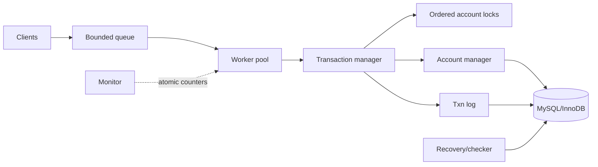
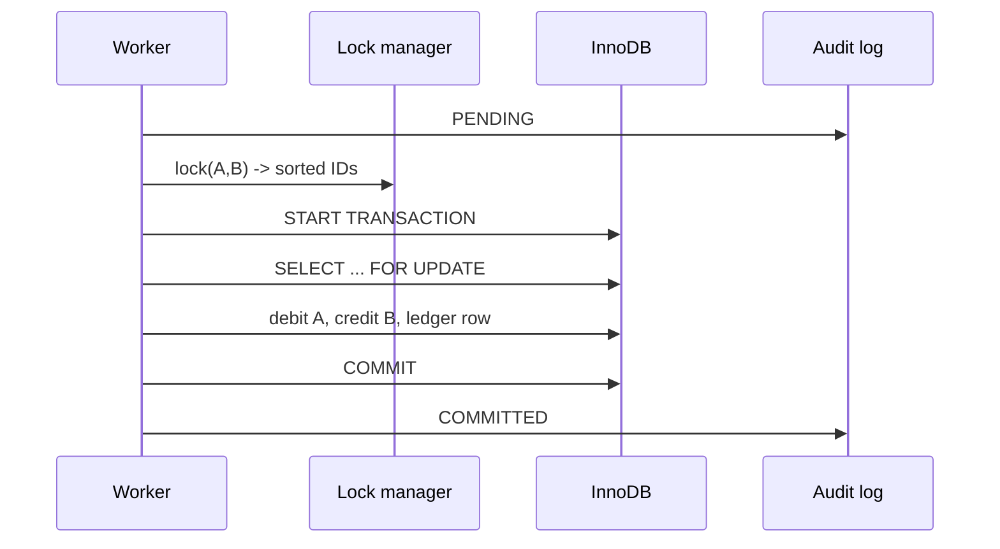
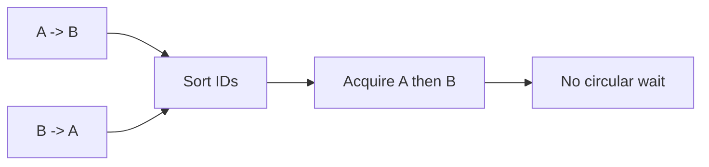
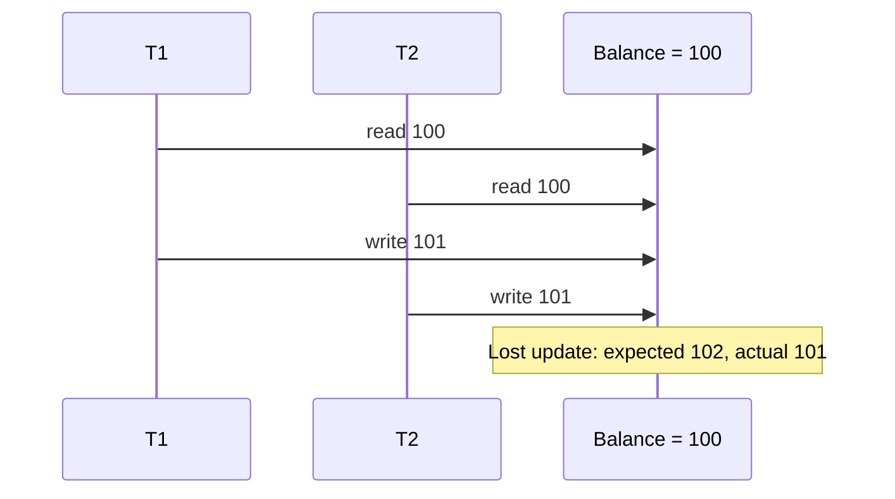

# Presentation Deck — Multithreaded Bank Transaction Management System

This Markdown deck is ready to transfer into PowerPoint, Google Slides, or a
course report. Each slide has a title, on-slide content, speaker notes, and a
reproducible command where a live demonstration is useful.

## Slide 1 — Title

**Multithreaded Bank Transaction Management System**

- C++20 + `std::thread`
- MySQL 8/InnoDB
- Bounded work queue, ordered locks, ACID transactions, recovery
- Operating Systems + DBMS integration project

**Speaker notes:** The system is intentionally small enough to explain, but it
contains both operating-system synchronization and database concurrency control.

## Slide 2 — Problem statement

Concurrent banking operations can cause:

- Lost updates
- Negative balances
- Half-completed transfers
- Deadlocks
- Ambiguous audit state after failure

**Goal:** process concurrent operations while preserving banking invariants.

**Speaker notes:** The unsafe path makes the lost-update problem visible. The
safe path addresses the same workload using ordered mutexes and database row
locks.

## Slide 3 — Requirements and success criteria

- Deposits, withdrawals, transfers, and balance checks
- Bounded queue and worker pool
- ACID commit/rollback and retry
- Idempotent request IDs
- Audit log and recovery
- Consistency checker I1–I5
- Live CLI monitor

**Invariants:**

1. Total money is conserved.
2. No balance is negative.
3. Every request has one final status.
4. No unresolved PENDING rows after recovery.
5. Ledger replay equals final balances.

## Slide 4 — Architecture



**Speaker notes:** The queue applies back-pressure. Workers own execution,
`TransactionManager` owns transaction boundaries, and the database remains the
source of truth for balances.

## Slide 5 — Database design

```text
customers 1 ---- N accounts 1 ---- N transactions
                           \
                            transaction_log
```

- InnoDB tables and foreign keys
- `CHECK (balance >= 0)`
- Unique `request_id` for idempotency
- `transaction_log`: `PENDING`, `COMMITTED`, `ROLLED_BACK`
- Money: integer minor units in C++, `DECIMAL(15,2)` in SQL

**Speaker notes:** The audit row is written before the main work on a separate
connection so an unfinished request remains visible for recovery.

## Slide 6 — One transfer transaction



If any step fails, the DB transaction rolls back and the audit row becomes
`ROLLED_BACK` with a reason.

## Slide 7 — Deadlock avoidance

Two opposing transfers may request `A -> B` and `B -> A`, but both acquire:

```text
min(A,B) first, then max(A,B)
```



MySQL deadlock/timeout errors 1213/1205 are retried up to the configured
limit as a second line of defense.

## Slide 8 — Unsafe race versus safe path



Run the evidence test:

```powershell
& "C:\Program Files\CMake\bin\ctest.exe" `
  --test-dir build-gcc --output-on-failure `
  -R "UnsafeRaceTest.R2ReportsLostUpdatesAcrossTwentyRuns"
```

**Speaker notes:** `--unsafe` is intentionally not the production path. It is a
controlled teaching mode that makes the race condition measurable.

## Slide 9 — Recovery and invariants

```text
startup -> Recovery -> no PENDING -> simulation
                    \
                     -> ConsistencyChecker I1-I5
```

Commands:

```powershell
.\build-gcc\bank.exe --recover
.\build-gcc\bank.exe --check --baseline-file results\baseline.txt
```

Expected checker fields:

```text
I1=PASS I2=PASS I3=PASS I4=PASS I5=PASS
```

**Speaker notes:** I1 and I5 require the complete external opening-balance
baseline because the current schema does not store opening balances.

## Slide 10 — Live monitor

Run:

```powershell
.\build-gcc\bank.exe --accounts 50 --clients 20 --ops 100 `
  --workers 4 --seed 42 --verbose
```

Example:

```text
[monitor t=1.00s] queue=12/256 active=4 committed=120 rolled_back=3
 total=123 throughput=123.00 tx/s avg_service_latency=4.10ms
 lock_waits_total=18
```

- Atomic diagnostic reads
- No MySQL polling from the monitor
- Condition-variable shutdown
- Monitor thread is always joined

## Slide 11 — Testing evidence

| Area | Evidence |
|---|---|
| F1–F9 | AccountManager integration tests |
| R1/R3 | Safe deposits and no-overdraft withdrawals |
| R2 | Repeated lost-update demonstration |
| D1/D2 | Opposing and ring transfers complete without deadlock |
| D3 | Forced retry and exhaustion tests |
| X1/X4 | Rollback fault injection and DB CHECK constraint |
| S1–S4 | Mixed, hotspot, queue-one, and small-pool stress tests |
| I1–I5 | Consistency checker and ledger replay |
| Monitor | DB-independent unit test |

**Evidence rule:** S5, X2, X3, and post-fix ASan S1 remain clearly labeled as
incomplete in the final report.

## Slide 12 — Performance artifacts

Include:

- [`throughput_vs_workers.png`](../results/throughput_vs_workers.png)
- [`latency_vs_workers.png`](../results/latency_vs_workers.png)
- [`safe_vs_unsafe_balance_error.png`](../results/safe_vs_unsafe_balance_error.png)
- [`retry_rate_lock_ordering.png`](../results/retry_rate_lock_ordering.png)

Recorded short-run worker averages are approximately:

```text
1 worker: 570 tx/s   2 workers: 816 tx/s
4 workers: 696 tx/s  8 workers: 545 tx/s
16 workers: 430 tx/s
```

These are local workload measurements, not a claim of linear scaling. The
unsupported isolation/hotspot/unordered-lock dimensions are labeled
`NOT_IMPLEMENTED` in the CSV files.

## Slide 13 — Limitations and next steps

- FR1 customer/account creation API is not implemented.
- X2 process-kill recovery harness is not implemented.
- X3 dropped-connection replacement seam is not implemented.
- S5 currently has seeds 1–16 recorded; 17–50 remain.
- Post-fix ASan S1 needs confirmation.
- Current user run is blocked by MySQL root authentication until `.env` is fixed.

**Speaker notes:** These are engineering boundaries, not hidden failures. The
report records them so the examiner can distinguish implemented behavior from
future work.

## Slide 14 — Closing

**What the project demonstrates:**

- OS-level synchronization and back-pressure
- DBMS-level ACID and row locking
- Deadlock avoidance by global ordering
- Durable audit/recovery structure
- Invariant-based correctness testing
- A reproducible CLI demonstration

**Closing sentence:** The safe path preserves correctness under concurrency;
the unsafe path shows exactly why the synchronization is necessary.
